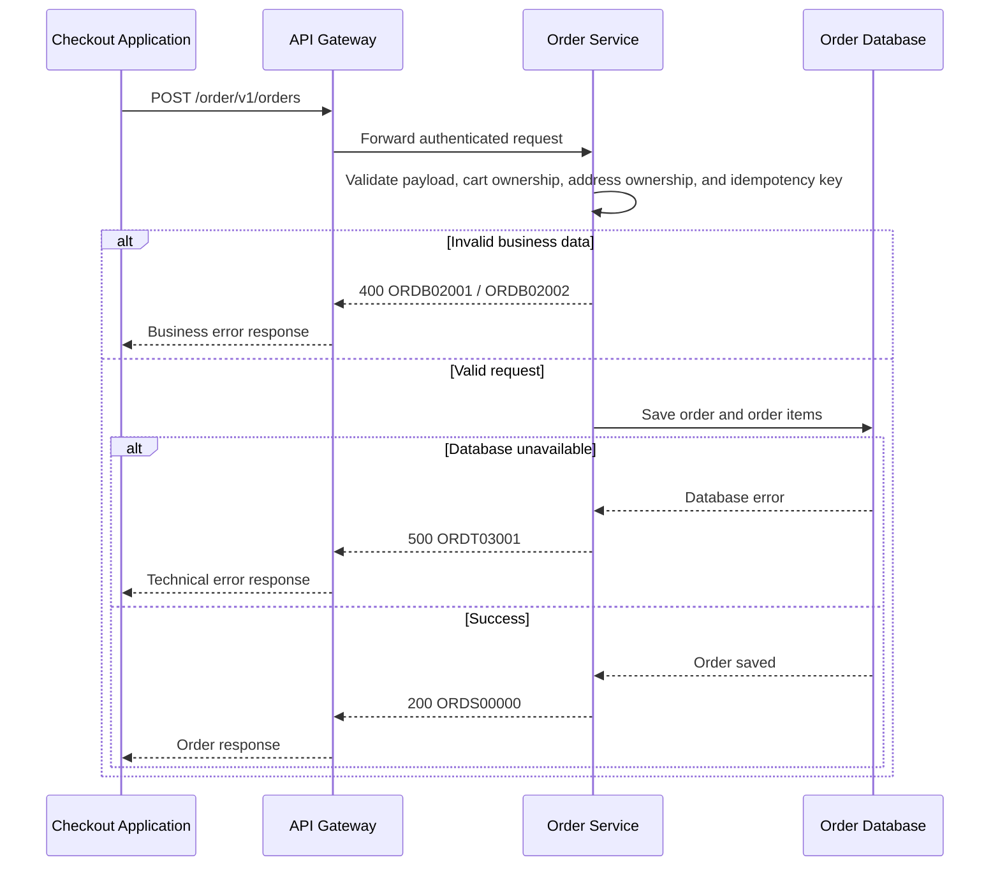

# Create Customer Order - Interface Agreement

> **Document Type:** API Contract  
> **Status:** Example  
> **Service / Domain:** Order Service  
> **Consumer / Partner:** Internal Checkout Application

## Design

No design reference is needed for this API example.

## Sequence Diagram



## Performance / SLA Targets

Illustrative targets only; replace with targets agreed by service owners before treating them as commitments.

| Success Rate | VUser                | CPU / Memory            | Response Time |
| ------------ | -------------------- | ----------------------- | ------------- |
| 99.9%        | 100 concurrent users | CPU < 70%; Memory < 75% | < 1 second    |

## General Information

| Component          | Value                                              |
| ------------------ | -------------------------------------------------- |
| Description        | Creates an order from a validated checkout request |
| Resource URL       | `{env}/order/v1/orders`                            |
| Transport Protocol | HTTPS                                              |
| Request Verb       | POST                                               |
| Content Type       | `application/json`                                 |
| Interaction Type   | Synchronous                                        |
| Security Policy    | OAuth 2.0 Bearer access token and `x-api-key`      |

### Path / Endpoint

| Section        | Value              |
| -------------- | ------------------ |
| Host / Domain  | `{env}`            |
| Service Name   | `order`            |
| Version        | `v1`               |
| Resource       | `orders`           |
| Final Endpoint | `/order/v1/orders` |

### API Versioning

- **Decision:** New Endpoint
- **Previous Endpoint:** Not applicable
- **Final Endpoint:** `/order/v1/orders`
- **Backward Compatibility:** Not applicable; this is the first version of this endpoint.
- **Reason:** The API introduces an order-creation capability.

## Business Rules

1. The submitted cart must belong to the customer identified in the request.
2. The shipping address must belong to that customer.
3. The cart must contain at least one available item.
4. The currency must be `IDR` for this example.
5. If a promotion code is provided, it must be active and applicable to the submitted cart.
6. The idempotency key identifies one order-submission attempt. Repeating a request with the same key returns the original result and does not create another order.

## Request Headers

`E` = Existing, `N` = New, `T` = Take Out. `M` = Mandatory, `O` = Optional, `C` = Conditional.

| Header            | E/N/T | Type   | M/O/C | Max Length | Description                 | Example                                |
| ----------------- | ----- | ------ | ----- | ---------: | --------------------------- | -------------------------------------- |
| `Authorization`   | E     | String | M     |       2048 | OAuth 2.0 access token      | `Bearer <access-token>`                |
| `Content-Type`    | E     | String | M     |         50 | Request media type          | `application/json`                     |
| `x-api-key`       | E     | String | M     |        256 | Client API key              | `<api-key>`                            |
| `idempotency-key` | N     | UUID   | M     |         36 | Unique key for this attempt | `21b4a7dd-34f7-49ff-9925-8d106cefae25` |

## Request Parameters

None. This endpoint has no path parameters.

## Request Query Parameters

None. This endpoint has no query parameters.

## Request Body

| Attribute           | E/N/T | Type    | M/O/C | Max Length | Description                         | Example                                |
| ------------------- | ----- | ------- | ----- | ---------: | ----------------------------------- | -------------------------------------- |
| `customerId`        | E     | UUID    | M     |         36 | Customer placing the order          | `21b4a7dd-34f7-49ff-9925-8d106cefae25` |
| `cartId`            | E     | UUID    | M     |         36 | Cart to convert into an order       | `af223b99-a37d-469a-8e18-53c0f546f29c` |
| `currency`          | N     | String  | M     |          3 | Currency for prices                 | `IDR`                                  |
| `items`             | N     | Array   | M     |          - | Items to order; at least one item   | `[{...}]`                              |
| `items[].productId` | N     | UUID    | M     |         36 | Product identifier                  | `78a23c30-887f-471d-91d2-9ea80dd51f74` |
| `items[].quantity`  | N     | Integer | M     |          4 | Number of units; must be greater 0  | `2`                                    |
| `items[].unitPrice` | N     | Number  | M     |         15 | Unit price; must be zero or greater | `75000`                                |
| `shippingAddressId` | E     | UUID    | M     |         36 | Customer shipping address           | `da8750c0-ae43-455b-961a-570236e06498` |
| `promoCode`         | N     | String  | O     |         30 | Optional promotion code             | `HEMAT10`                              |
| `paymentMethod`     | N     | String  | M     |         30 | Selected payment method             | `VIRTUAL_ACCOUNT`                      |
| `notes`             | N     | String  | O     |        500 | Optional delivery instruction       | `Leave at reception.`                  |

### Example Request Body

```json
{
  "customerId": "21b4a7dd-34f7-49ff-9925-8d106cefae25",
  "cartId": "af223b99-a37d-469a-8e18-53c0f546f29c",
  "currency": "IDR",
  "items": [
    {
      "productId": "78a23c30-887f-471d-91d2-9ea80dd51f74",
      "quantity": 2,
      "unitPrice": 75000
    }
  ],
  "shippingAddressId": "da8750c0-ae43-455b-961a-570236e06498",
  "promoCode": "HEMAT10",
  "paymentMethod": "VIRTUAL_ACCOUNT",
  "notes": "Leave at reception."
}
```

### Request Validation

1. `customerId`, `cartId`, `currency`, `items`, `shippingAddressId`, and `paymentMethod` are required.
2. `items` must contain at least one item.
3. Each `items[].quantity` must be greater than `0`.
4. Each `items[].unitPrice` must be greater than or equal to `0`.
5. `currency` must be `IDR` for this example.
6. If `promoCode` is present, it must be active and applicable to the cart.
7. The `idempotency-key` header must be a valid UUID. Reuse of a key must not create a duplicate order.
8. The cart and shipping address must belong to `customerId`; otherwise return the corresponding business error.

## Response Body

The response envelope contains `status` and `data`. `status` contains a service status `code` and human-readable `message`.

| Attribute          | E/N/T | Type   | M/O/C | Max Length | Description                  | Example                                |
| ------------------ | ----- | ------ | ----- | ---------: | ---------------------------- | -------------------------------------- |
| `status`           | E     | Object | M     |          - | Response status              | `{}`                                   |
| `status.code`      | E     | String | M     |         20 | Service status code          | `ORDS00000`                            |
| `status.message`   | E     | String | M     |        200 | Human-readable result        | `Order created successfully`           |
| `data`             | E     | Object | C     |          - | Order data on success        | `{}`                                   |
| `data.orderId`     | N     | UUID   | C     |         36 | Created order identifier     | `4fb5a4cf-3782-4dde-98fb-62127f2b645b` |
| `data.orderNumber` | N     | String | C     |         30 | Customer-facing order number | `ORD-20261002-000123`                  |
| `data.status`      | N     | String | C     |         20 | Initial order status         | `CREATED`                              |
| `data.totalAmount` | N     | Number | C     |         15 | Total order amount           | `150000`                               |
| `data.currency`    | N     | String | C     |          3 | Order currency               | `IDR`                                  |
| `data.createdAt`   | N     | String | C     |         35 | Creation time in ISO 8601    | `2026-10-02T10:15:20+07:00`            |

### Success Example

```json
{
  "status": {
    "code": "ORDS00000",
    "message": "Order created successfully"
  },
  "data": {
    "orderId": "4fb5a4cf-3782-4dde-98fb-62127f2b645b",
    "orderNumber": "ORD-20261002-000123",
    "status": "CREATED",
    "totalAmount": 150000,
    "currency": "IDR",
    "createdAt": "2026-10-02T10:15:20+07:00"
  }
}
```

### Business Error Example

```json
{
  "status": {
    "code": "ORDB02001",
    "message": "Cart does not belong to the submitted customer"
  },
  "data": null
}
```

### Technical Error Example

```json
{
  "status": {
    "code": "ORDT03001",
    "message": "Order database is unavailable"
  },
  "data": null
}
```

## HTTP Status Codes

| HTTP Status | Usage                                                                          |
| ----------- | ------------------------------------------------------------------------------ |
| `200`       | Order created successfully or existing result returned for an idempotent retry |
| `400`       | Invalid request or business validation error                                   |
| `500`       | Unexpected technical failure in the Order Service or a required dependency     |

## Service Status Codes

Format:

```text
[Service Prefix][Status Type][Category][Specific Error Code]
```

Example:

```text
ORDT03001
```

| Part                | Rule                                        | Example          |
| ------------------- | ------------------------------------------- | ---------------- |
| Service Prefix      | 3 uppercase letters identifying the service | `ORD`            |
| Status Type         | 1 uppercase letter                          | `T`, `B`, `S`    |
| Category            | 2 digits, zero-padded                       | `00`, `02`, `03` |
| Specific Error Code | 3 digits, zero-padded                       | `000`, `001`     |

| Category | Business category  | Technical category |
| -------- | ------------------ | ------------------ |
| `00`     | General / default  | Generic exception  |
| `01`     | Authentication     | Data unmarshalling |
| `02`     | User validation    | External service   |
| `03`     | Request payment    | Database           |
| `04`     | Request fulfilment | Object storage     |

| Http Status | Code        | E/N/T | Type      | Category   | Message                                          |
| ----------- | ----------- | ----- | --------- | ---------- | ------------------------------------------------ |
| 200         | `ORDS00000` | E     | Success   | General    | Order created successfully                       |
| 400         | `ORDB02001` | E     | Business  | Validation | Cart does not belong to the submitted customer   |
| 400         | `ORDB02002` | E     | Business  | Validation | Shipping address does not belong to the customer |
| 500         | `ORDT03001` | E     | Technical | Database   | Order database is unavailable                    |
| 500         | `ORDT00000` | E     | Technical | Generic    | Unexpected internal server error                 |
