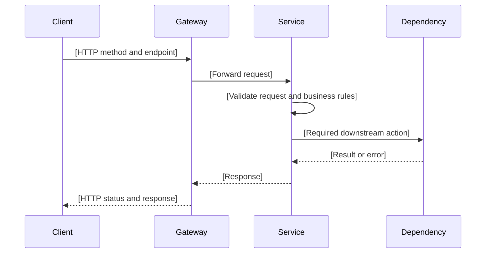

# [Service / API Purpose] - Interface Agreement

> **Document Type:** API Contract  
> **Status:** [Draft / Final]  
> **Service / Domain:** [Service Name]  
> **Consumer / Partner:** [Internal / Specific Partner]

## Design

Include a design or reference image when it helps explain the API interaction. Use a relative path to an asset included with this document. Remove this section’s image example when no design is relevant.


## Sequence Diagram

Show the request and response flow across the client, gateway, service, and dependencies. Include important headers or payload details, validation, success, business-error, and technical-error paths. Keep participants and steps aligned with the API described in this document.



## Performance / SLA Targets

Record agreed service targets and the conditions under which they apply. Include units and measurement context. Use `TBD` for targets that have not been agreed; do not present illustrative values as commitments.

| Success Rate | VUser              | CPU / Memory       | Response Time     |
| ------------ | ------------------ | ------------------ | ----------------- |
| [Target]     | [Concurrent users] | [Resource targets] | [Target and unit] |

## General Information

Describe the API’s purpose and agreed interaction characteristics. Use consistent values for the endpoint, transport, method, content type, interaction type, and security policy.

| Component          | Value                                           |
| ------------------ | ----------------------------------------------- |
| Description        | [Business purpose of the API]                   |
| Resource URL       | [Environment and endpoint]                      |
| Transport Protocol | [Protocol]                                      |
| Request Verb       | [HTTP method]                                   |
| Content Type       | [Media type]                                    |
| Interaction Type   | [Synchronous / Asynchronous]                    |
| Security Policy    | [Authentication and authorization requirements] |

### Path / Endpoint

Break down the endpoint consistently with the service’s routing convention.

| Section        | Value                             |
| -------------- | --------------------------------- |
| Host / Domain  | [Host or environment placeholder] |
| Service Name   | [Service name]                    |
| Version        | [API version]                     |
| Resource       | [Resource path]                   |
| Final Endpoint | [Complete path]                   |

### API Versioning

State the versioning decision and its effect on existing consumers. Explain compatibility and the reason for the decision. Use `Not applicable` only when the field truly does not apply.

- **Decision:** [New Endpoint / Existing Endpoint / Other approved option]
- **Previous Endpoint:** [Endpoint or Not applicable]
- **Final Endpoint:** [Endpoint]
- **Backward Compatibility:** [Compatibility impact]
- **Reason:** [Reason for the versioning decision]

## Business Rules

List business policies and conditions that affect this API. State the condition and resulting behavior clearly. Include authorization, ownership, uniqueness, timing, and other rules only when applicable. Reference the rule owner or source when known.

1. [When condition applies], [business outcome or restriction].

## Request Headers

Document headers accepted by the endpoint. For each header, identify whether it is expected, its data type, whether it is mandatory, optional, or conditional, limits where applicable, its meaning, and a representative example. Use `E` for Existing, `N` for New, and `T` for Take Out in the E/N/T column. Use `M` for Mandatory, `O` for Optional, and `C` for Conditional in the M/O/C column.

| Header          | E/N/T   | Type   |   M/O/C | Max Length   | Description            | Example     |
| --------------- | ------- | ------ | ------: | ------------ | ---------------------- | ----------- |
| `[header-name]` | [E/N/T] | [Type] | [M/O/C] | [Limit or -] | [Purpose or condition] | `[example]` |

## Request Parameters

Document path or other non-query parameters. Describe format, requiredness, constraints, and a representative value. If none apply, state `None`.

| Parameter     | E/N/T   | Type   |   M/O/C | Max Length   | Description             | Example     |
| ------------- | ------- | ------ | ------: | ------------ | ----------------------- | ----------- |
| `[parameter]` | [E/N/T] | [Type] | [M/O/C] | [Limit or -] | [Purpose or constraint] | `[example]` |

## Request Query Parameters

Document query-string parameters, including defaults and allowed values where relevant. If none apply, state `None`.

| Parameter     | E/N/T   | Type   |   M/O/C | Max Length   | Description                           | Example     |
| ------------- | ------- | ------ | ------: | ------------ | ------------------------------------- | ----------- |
| `[parameter]` | [E/N/T] | [Type] | [M/O/C] | [Limit or -] | [Purpose, default, or allowed values] | `[example]` |

## Request Body

Describe every request field, including nested and repeated fields. Specify type, requiredness, constraints or length limits, meaning, and a representative value. Keep examples consistent with the validation rules and JSON example.

| Attribute     | E/N/T   | Type   |   M/O/C | Max Length   | Description               | Example     |
| ------------- | ------- | ------ | ------: | ------------ | ------------------------- | ----------- |
| `[attribute]` | [E/N/T] | [Type] | [M/O/C] | [Limit or -] | [Meaning and constraints] | `[example]` |

### Example Request Body

Provide valid JSON showing a representative request. Include required fields and useful optional fields; use values that match the field definitions and validation rules.

```json
{
  "[field]": "[representative value]"
}
```

### Request Validation

List validation rules that apply to the request. Cover required fields, formats, ranges, cross-field relationships, ownership or authorization checks, and idempotency where relevant. State the resulting behavior for invalid input and keep these rules consistent with Business Rules and the error contract.

1. `[Field or condition]` must [validation rule]; otherwise [error behavior].

## Response Body

Describe the response envelope and fields, including requiredness, type, meaning, and representative values. Explain pagination or metadata when present. Ensure the table agrees with the examples and status-code definitions.

| Attribute     | E/N/T   | Type   |   M/O/C | Max Length   | Description | Example     |
| ------------- | ------- | ------ | ------: | ------------ | ----------- | ----------- |
| `[attribute]` | [E/N/T] | [Type] | [M/O/C] | [Limit or -] | [Meaning]   | `[example]` |

### Success Example

Provide a representative successful response in valid JSON. Ensure fields and values match the Response Body definition and the HTTP and service status-code tables.

```json
{
  "status": {
    "code": "[success code]",
    "message": "[Success message]"
  },
  "data": {}
}
```

### Business Error Example

Provide a representative business-error response in valid JSON. Use the business status code and message defined in the status-code table.

```json
{
  "status": {
    "code": "[business error code]",
    "message": "[Business error message]"
  },
  "data": null
}
```

### Technical Error Example

Provide a representative technical-error response in valid JSON. Use the technical status code and message defined in the status-code table. Avoid exposing sensitive internal details.

```json
{
  "status": {
    "code": "[technical error code]",
    "message": "[Safe error message]"
  },
  "data": null
}
```

## HTTP Status Codes

Map each relevant HTTP status to the conditions in which the API returns it. Keep the available status-code options below unchanged and tailor only the usage descriptions to the endpoint.

| HTTP Status | Usage                                                         |
| ----------- | ------------------------------------------------------------- |
| `200`       | [Successful request or accepted retry, if applicable]         |
| `400`       | [Invalid request or business validation error, if applicable] |
| `500`       | [Unexpected technical failure, if applicable]                 |

## Service Status Codes

Follow the service status-code format and category options below. Define only codes used by this API, make each code unique, and keep code, HTTP status, type, category, and message consistent with the response examples.

Format:

```text
[Service Prefix][Status Type][Category][Specific Error Code]
```

Example:

```text
ORDT03001
```

| Part                | Rule                                        | Example          |
| ------------------- | ------------------------------------------- | ---------------- |
| Service Prefix      | 3 uppercase letters identifying the service | `ORD`            |
| Status Type         | 1 uppercase letter                          | `T`, `B`, `S`    |
| Category            | 2 digits, zero-padded                       | `00`, `02`, `03` |
| Specific Error Code | 3 digits, zero-padded                       | `000`, `001`     |

| Category | Business category  | Technical category |
| -------- | ------------------ | ------------------ |
| `00`     | General / default  | Generic exception  |
| `01`     | Authentication     | Data unmarshalling |
| `02`     | User validation    | External service   |
| `03`     | Request payment    | Database           |
| `04`     | Request fulfilment | Object storage     |

| Http Status | Code        | E/N/T | Type      | Category | Message                          |
| ----------- | ----------- | ----- | --------- | -------- | -------------------------------- |
| 200         | `ORDS00000` | E     | Success   | General  | Order created successfully       |
| 500         | `ORDT03001` | E     | Technical | Database | Order database is unavailable    |
| 500         | `ORDT00000` | E     | Technical | Generic  | Unexpected internal server error |
